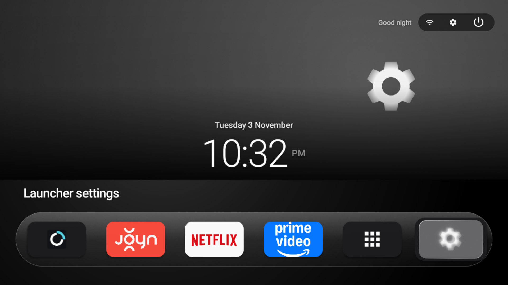
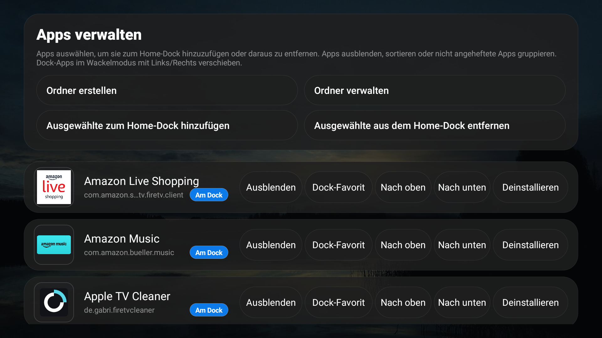

# Apple TV Launcher for Android TV

<p align="center">
  
</p>
<p align="center"><strong>A remote-friendly, tvOS-inspired home screen for Android TV and Fire TV.</strong></p>

> [!WARNING]
> **Experimental test version — not production-ready.** Bugs, incomplete features, and device-specific problems are expected. It has only been smoke-tested on a Fire TV running Fire OS 7 / Android 9. Back up your setup before changing your default home screen or using the optional device tools.

This Fire TV build uses the package ID `com.appletv.launcher.firetv`, so it can coexist with the signed Amazon launcher as a fallback.

## Screenshots

These are captures from our Fire TV launcher build; the interface can vary by device and installed apps.

| Home screen | App management | Launcher settings |
|---|---|---|
|  |  |  |

## Downloads

**[Latest experimental release](https://github.com/ZyLuxx7/FireTvAppleLauncher/releases/latest)**

| APK | Package | Download |
|---|---|---|
| Apple TV Launcher | `com.appletv.launcher.firetv` | [AppleTVLauncher.apk](https://github.com/ZyLuxx7/FireTvAppleLauncher/releases/latest/download/AppleTVLauncher.apk) |
| Apple TV Switcher (Home Redirect) | `de.gabri.firetvhomehelper` | [AppleTVSwitcher.apk](https://github.com/ZyLuxx7/FireTvAppleLauncher/releases/latest/download/AppleTVSwitcher.apk) |
| Apple TV Background Cleaner | `de.gabri.firetvcleaner` | [AppleTVBackgroundCleaner.apk](https://github.com/ZyLuxx7/FireTvAppleLauncher/releases/latest/download/AppleTVBackgroundCleaner.apk) |

To update the launcher from the TV, open **Settings → Updates → Launcher Update** and scan the QR code. The phone page pre-fills the latest launcher APK link; tap **Check APK links**, select the verified launcher, and confirm installation on the TV. The built-in updater accepts only launcher APKs; install the Switcher and Background Cleaner as separate apps. These experimental APKs are signed with the same local debug key, so updates require a matching signing certificate. Android still asks for installation confirmation.

## Features

- **Home screen and app organization:** configurable dock, app grid, app banners, wallpaper and Top Shelf artwork.
- **App manager:** hide apps, reorder the list, manage dock items, and group apps into folders.
- **Recent apps:** remote-friendly task switcher with app usage information when Android grants usage access.
- **Now Playing:** media-session metadata, artwork, playback progress, lyrics, and an audio-reactive visualizer when supported by the device and player.
- **Lyrics:** optional lyric providers, including LRCLIB. A lyrics lookup can send the track title, artist, album, and duration to LRCLIB.
- **Spotify and audio routing:** experimental Spotify Connect discovery and audio-output controls. Device discovery depends on the TV, Spotify, and local network.
- **Quick controls:** launcher settings, network and audio controls, and TV power options where supported by the device.
- **Launcher updates:** a TV-displayed QR code opens a same-Wi-Fi updater with a one-time token and PIN. It checks up to five direct links, including the [latest GitHub launcher APK](https://github.com/ZyLuxx7/FireTvAppleLauncher/releases/latest/download/AppleTVLauncher.apk), and offers only APKs matching the installed package, signing key, and version; Android still asks for installation confirmation on the TV.
- **Appearance:** themes, wallpaper choices, focus-glass effects, and English, German, French, and Spanish UI strings.
- **Permission status:** settings show the state of supported accessibility services and the equalizer's audio permission.

## Permissions and limitations

- Android requires the user to enable accessibility services in system settings. The launcher can report their status and open those settings, but cannot enable them silently.
- The QR updater may open Android's “Install unknown apps” setting, which the user must approve. Android's installation confirmation remains required; the updater cannot grant accessibility or other protected permissions.
- The equalizer needs Android's `RECORD_AUDIO` runtime permission. Tap its status row in launcher settings and approve Android's permission prompt to use audio capture.
- Continue Watching items appear only when the focused app publishes supported Android TV Watch Next records.
- Fire OS and Android TV behavior varies by manufacturer and version. Features that work on one TV may be unavailable or behave differently on another.

## Build and install

Requirements: JDK 21 and the Android SDK configured for this project.

```powershell
.\gradlew.bat :app:testDebugUnitTest :app:assembleDebug
adb connect <TV_IP>:5555
adb install -r app\build\outputs\apk\debug\app-debug.apk
```

The debug APK is written to `app\build\outputs\apk\debug\app-debug.apk`. To use the launcher as Home, choose it through the TV's own default-home settings. Keep the original launcher available as a fallback.

## Optional device tools

The `tools/` and `profiles/` directories contain separate experimental ADB audit, setup, and restore utilities. These can change device settings or disable packages. Read the scripts and review their proposed changes for your exact TV model before running them; they are not required to build or use the launcher.

## Feedback and contributions

This is a test project, and help is welcome. Please report reproducible bugs, propose improvements, or contribute fixes. Include the TV model, Fire OS/Android version, steps to reproduce, and expected versus actual behavior. Remove account details, network names, tokens, and other personal information from screenshots or logs before sharing them.

## License and credits

The project is licensed under the [MIT License](LICENSE). Third-party notices are in [THIRD_PARTY_LICENSES.txt](app/src/main/assets/THIRD_PARTY_LICENSES.txt).

The bundled landscape is a modified crop and color adjustment of [“Autumn Finnish sunset (54882977485)” by yrjö jyske](https://commons.wikimedia.org/wiki/File:Autumn_Finnish_sunset_(54882977485).jpg), licensed under [CC BY 4.0](https://creativecommons.org/licenses/by/4.0/).

This project is independent and is not affiliated with Apple, Amazon, Spotify, or the streaming services shown in screenshots.
