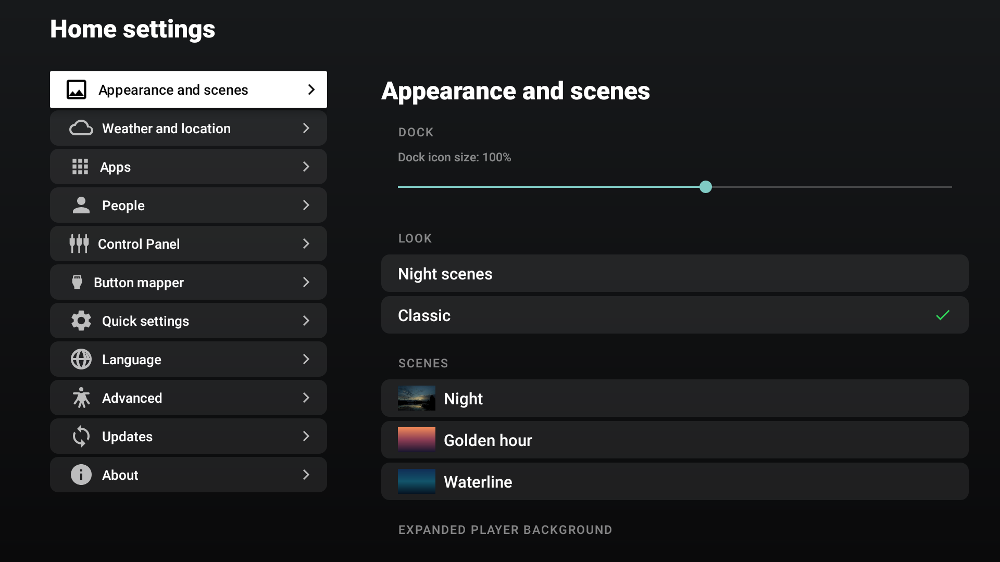

# Apple TV Launcher for Android TV

<p align="center">
  
</p>
<p align="center"><strong>A remote-friendly, tvOS-inspired home screen for Android TV and Fire TV.</strong></p>

> [!WARNING]
> **Experimental test version — not production-ready.** Bugs, incomplete features, and device-specific problems are expected. It has only been smoke-tested on a Fire TV running Fire OS 7 / Android 9. Back up your setup before changing your default home screen or using the optional device tools.

This Fire TV build uses the package ID `com.appletv.launcher.firetv`, so it can coexist with the signed Amazon launcher as a fallback.

Current source version: **1.0.3-firetv** (version code 9). Available as a clearly marked experimental GitHub test prerelease; the APK is a debug build and is not production-ready.

## Screenshots

These unmodified screenshots were captured live from the launcher on a Fire TV Stick (device identifier AFTSS) on 24 November 2026. The interface and app list can vary by device and installed apps.

| Home screen | Apps library | Launcher settings |
|---|---|---|
|  |  |  |

## Downloads

**[V1.0.3 experimental test prerelease](https://github.com/ZyLuxx7/FireTvAppleLauncher/releases/tag/v1.0.3-test)**

| APK | Package | Download |
|---|---|---|
| Apple TV Launcher | `com.appletv.launcher.firetv` | [AppleTVLauncher.apk](https://github.com/ZyLuxx7/FireTvAppleLauncher/releases/download/v1.0.3-test/AppleTVLauncher.apk) |
| Apple TV Switcher (Home Redirect) | `de.gabri.firetvhomehelper` | [AppleTVSwitcher.apk](https://github.com/ZyLuxx7/FireTvAppleLauncher/releases/latest/download/AppleTVSwitcher.apk) |
| Apple TV Background Cleaner | `de.gabri.firetvcleaner` | [AppleTVBackgroundCleaner.apk](https://github.com/ZyLuxx7/FireTvAppleLauncher/releases/latest/download/AppleTVBackgroundCleaner.apk) |

To update the launcher from the TV, open **Settings → Updates → Launcher Update** and scan the QR code. The TV displays the phone connection and session countdown; the phone page pre-fills the latest launcher APK link and also lets you choose an APK already downloaded on the phone. A selected file is sent directly to the TV over the same Wi-Fi, not to GitHub or another service. Tap **Check APK links** or **Upload APK to TV**, select the verified launcher, and confirm installation on the TV. The launcher shows upload/download and verification progress before handing off to Android. The built-in updater accepts only launcher APKs; install the Switcher and Background Cleaner as separate apps. In-place updates require the same package and signing certificate; Android still asks for installation confirmation.

The private signing key is not included in this repository. For release builds, set all four values locally: `releaseKeystore`, `releaseStorePassword`, `releaseKeyAlias`, and `releaseKeyPassword`, either as user-level Gradle properties (for example `%USERPROFILE%\.gradle\gradle.properties`) or the `APPLE_LAUNCHER_RELEASE_*` environment variables. The launcher, Home Redirect switcher, and cleaner use these settings; their release builds fail if any value is missing. Keep the keystore and credentials out of the repositories, and reuse the same private signing certificate for future in-place updates.

## Features

- **Home screen and app organization:** configurable dock, app grid, app banners, wallpaper and Top Shelf artwork.
- **App manager:** hide apps, reorder the list, manage dock items, and group apps into folders.
- **Recent apps:** remote-friendly task switcher with app usage information when Android grants usage access. App discovery runs off the UI thread, and the optional Home Redirect helper uses a shorter launch delay.
- **Now Playing:** media-session metadata, artwork aligned with the expanded-player title, playback progress, lyrics, and an audio-reactive visualizer when supported by the device and player. Lyrics toggling fades the lyrics and progress bar while animating the bar's width.
- **Lyrics:** optional lyric providers, including LRCLIB. A lyrics lookup can send the track title, artist, album, and duration to LRCLIB.
- **Spotify and audio routing:** experimental Spotify Connect discovery and audio-output controls. Device discovery depends on the TV, Spotify, and local network.
- **Quick controls:** launcher settings, network and audio controls, and TV power options where supported by the device.
- **Launcher updates:** a TV-displayed QR code opens a same-Wi-Fi updater with a one-time token and PIN. The phone countdown updates every second; the session can remain active in the background with a Home status card. Submit up to five direct links, including the [V1.0.3 GitHub test APK](https://github.com/ZyLuxx7/FireTvAppleLauncher/releases/download/v1.0.3-test/AppleTVLauncher.apk), or upload an APK already downloaded to the phone. The updater offers only APKs matching the installed package, signing key, and version. After installation, a short Home-startup check selects a lightweight or full-effects profile; version notes and required Terms of Use acceptance then appear, and the terms remain available under **Settings → System → Update Terms of Use**.
- **Onboarding:** version-aware Home and Spotify player tutorials explain the remote controls and can be skipped from the remote’s Menu key.
- **Appearance:** themes, wallpaper choices, focus-glass effects, and English, German, French, and Spanish UI strings.
- **Permission status:** settings show the state of supported accessibility services and the equalizer's audio permission.

## Permissions and limitations

- Android requires the user to enable accessibility services in system settings. The launcher can report their status and open those settings, but cannot enable them silently.
- The QR updater may open Android's “Install unknown apps” setting, which the user must approve. Android's installation confirmation remains required and its system installer cannot be restyled by the launcher; the launcher displays its own download and verification panel before handing off. The updater cannot grant accessibility or other protected permissions.
- The equalizer needs Android's `RECORD_AUDIO` runtime permission. Tap its status row in launcher settings and approve Android's permission prompt to use audio capture.
- Continue Watching items appear only when the focused app publishes supported Android TV Watch Next records.
- Fire OS and Android TV behavior varies by manufacturer and version. Features that work on one TV may be unavailable or behave differently on another.

## Build and install

Requirements: JDK 21 and the Android SDK configured for this project.

```powershell
.\gradlew.bat :app:testDebugUnitTest :app:assembleDebug
adb connect <TV_IP>:5555
adb install -r app\build\outputs\apk\debug\app-debug.apk
```

The debug APK is written to `app\build\outputs\apk\debug\app-debug.apk`. To use the launcher as Home, choose it through the TV's own default-home settings. Keep the original launcher available as a fallback.

After configuring local release signing, build the launcher with `.\gradlew.bat :app:assembleRelease`. Build the Home Redirect switcher and cleaner from this directory with `.\gradlew.bat -p ..\FireTvHomeRedirect :app:assembleRelease :cleaner:assembleRelease`.

## Optional device tools

The `tools/` and `profiles/` directories contain separate experimental ADB audit, setup, and restore utilities. These can change device settings or disable packages. Read the scripts and review their proposed changes for your exact TV model before running them; they are not required to build or use the launcher.

## Feedback and contributions

This is a test project, and help is welcome. Please report reproducible bugs, propose improvements, or contribute fixes. Include the TV model, Fire OS/Android version, steps to reproduce, and expected versus actual behavior. Remove account details, network names, tokens, and other personal information from screenshots or logs before sharing them.

## License and credits

The project is licensed under the [MIT License](LICENSE). Third-party notices are in [THIRD_PARTY_LICENSES.txt](app/src/main/assets/THIRD_PARTY_LICENSES.txt).

The bundled landscape is a modified crop and color adjustment of [“Autumn Finnish sunset (54882977485)” by yrjö jyske](https://commons.wikimedia.org/wiki/File:Autumn_Finnish_sunset_(54882977485).jpg), licensed under [CC BY 4.0](https://creativecommons.org/licenses/by/4.0/).

This project is independent and is not affiliated with Apple, Amazon, Spotify, or the streaming services shown in screenshots.
